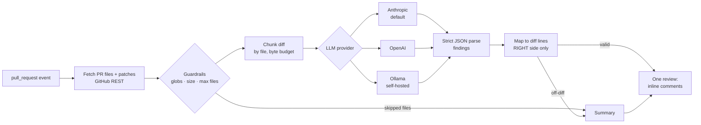

# ai-code-review-action

A GitHub Action that reviews pull requests with an LLM and posts **one** review with inline comments, **only on
lines the PR actually changed**, under hard cost limits.

> **Status: in active development.** Built in public, one pull request per milestone. See [Roadmap](#roadmap).
> It has not yet been run against a live model; every test uses mocked providers.

## The problem

LLM review bots usually fail in one of three ways:

1. **Noise.** They comment on unchanged code, repeat the same finding on every push, or flag style a linter
   already enforces. Reviewers learn to ignore them.
2. **Broken anchors.** The model invents a line number. GitHub rejects the whole review with `422`, or the comment
   lands on the wrong line.
3. **Unbounded cost.** A lockfile update or a generated client sends 2 MB of diff to a frontier model.

This action deals with each of these in code. It does not rely on the prompt alone:

- Findings are **validated against the diff hunks**. A finding on a line outside the diff never becomes an inline
  comment. It moves to the review summary or is dropped ([ADR-0001](docs/adr/0001-comment-only-on-diff-lines.md)).
- Every vendor's **native structured output** (a JSON schema) is used, and the result is parsed again strictly
  ([ADR-0002](docs/adr/0002-pluggable-providers-with-native-structured-output.md)).
- **Guardrails come before any model call.** These are max files, max diff bytes, max output tokens and
  include/exclude globs. Lockfiles, generated code and binaries are excluded by default.
- **The diff is treated as untrusted input.** The action never executes PR code. It asks for no write permission
  beyond posting a review, and its prompt says that instructions inside the code are data, not commands
  ([ADR-0003](docs/adr/0003-diff-is-untrusted-input.md)).

## How it works



| Step       | Module (planned) | Notes                                                                               |
| ---------- | ---------------- | ----------------------------------------------------------------------------------- |
| Fetch      | `src/github/`    | `pulls.listFiles` gives per-file patches without cloning the repo                   |
| Filter     | `src/filter.ts`  | include/exclude globs, per-file byte cap, skip binaries and removed files           |
| Diff model | `src/diff/`      | parse unified-diff hunks into the set of commentable `RIGHT`-side lines             |
| Chunk      | `src/chunk.ts`   | whole files per chunk where possible, never more than the byte budget               |
| Provider   | `src/providers/` | `Provider.review(prompt) → Finding[]`. Anthropic, OpenAI, Ollama                    |
| Map        | `src/review/`    | move off-diff findings to the summary and dedupe, then build the review payload     |
| Post       | `src/github/`    | a single `POST /pulls/{n}/reviews` with `event: COMMENT` (never approves or blocks) |

## Usage

```yaml
# .github/workflows/ai-review.yml
name: AI review
on:
  pull_request:
    types: [opened, synchronize, reopened, ready_for_review]

permissions:
  contents: read
  pull-requests: write

jobs:
  review:
    if: ${{ !github.event.pull_request.draft }}
    runs-on: ubuntu-latest
    steps:
      - uses: adilKhan72/ai-code-review-action@v0 # not released yet; see Roadmap
        with:
          provider: anthropic
          api-key: ${{ secrets.ANTHROPIC_API_KEY }}
          max-files: 30
          max-diff-bytes: 200000
          exclude: |
            **/*.lock
            dist/**
```

> Pull requests from forks do not receive repository secrets with `pull_request`. Do not switch to
> `pull_request_target` to work around this unless you understand the risk. This action never checks out PR code,
> but other steps in your job might.

## Configuration

Inputs as planned. They are implemented milestone by milestone. `action.yml` is the source of truth once it
exists.

| Input                 | Default                                        | Purpose                                                      |
| --------------------- | ---------------------------------------------- | ------------------------------------------------------------ |
| `provider`            | `anthropic`                                    | `anthropic`, `openai` or `ollama`                            |
| `model`               | per provider (`claude-opus-5-5` for Anthropic) | Model id                                                     |
| `api-key`             | none                                           | Provider API key (not needed for Ollama)                     |
| `base-url`            | per provider                                   | e.g. a self-hosted Ollama URL                                |
| `github-token`        | `${{ github.token }}`                          | Token used to read the PR and post the review                |
| `include` / `exclude` | sensible defaults                              | Newline-separated globs                                      |
| `max-files`           | `30`                                           | Files above this count are skipped and listed in the summary |
| `max-diff-bytes`      | `200000`                                       | Total patch budget sent to the model                         |
| `max-output-tokens`   | `16000`                                        | Per-request output cap                                       |
| `min-severity`        | `low`                                          | Drop findings below `low` / `medium` / `high` / `critical`   |
| `skip-draft`          | `true`                                         | Do nothing on draft PRs                                      |

A repo-level `.github/ai-review.yml` (house rules, severity threshold, ignore paths) is planned for Milestone 3.

## Roadmap

| Milestone | Scope                                                                                                                                                                  | Status  |
| --------- | ---------------------------------------------------------------------------------------------------------------------------------------------------------------------- | ------- |
| 0         | README, ADRs, licence                                                                                                                                                  | Done    |
| 1         | TypeScript action skeleton: `action.yml`, inputs, vitest, eslint, esbuild bundle in `dist/`, CI that verifies `dist/` is current                                       | Done    |
| 2         | Review engine: fetch diff, filter, chunk, provider interface (Anthropic, OpenAI, Ollama), strict JSON findings, diff-line mapping, single review, cost guardrails      | Planned |
| 3         | `.github/ai-review.yml` config (rules, threshold, ignore paths), no duplicate comments on re-runs                                                                      | Planned |
| 4         | Dogfood with a live model on this repo and on [loan-underwriting-ai](https://github.com/adilKhan72/loan-underwriting-ai). Publish real review examples and cost per PR | Planned |
| 5         | Optional Playwright E2E test suggestions from linked user stories                                                                                                      | Planned |
| 6         | `v1` release and GitHub Marketplace listing                                                                                                                            | Planned |

## Development

```bash
npm ci
npm run all      # prettier check, eslint, tsc, vitest, esbuild bundle
```

The action runs from the committed bundle `dist/index.cjs` on the `node24` runtime. CI rebuilds it and fails if
the committed copy is stale. It also runs the bundle as a real action (`uses: ./`) to catch a broken `action.yml`.

## Architecture decisions

- [ADR-0001: Comment only on diff lines](docs/adr/0001-comment-only-on-diff-lines.md)
- [ADR-0002: Pluggable providers with native structured output](docs/adr/0002-pluggable-providers-with-native-structured-output.md)
- [ADR-0003: The diff is untrusted input](docs/adr/0003-diff-is-untrusted-input.md)

## Licence

[MIT](LICENSE) © 2026 Adil Khan
