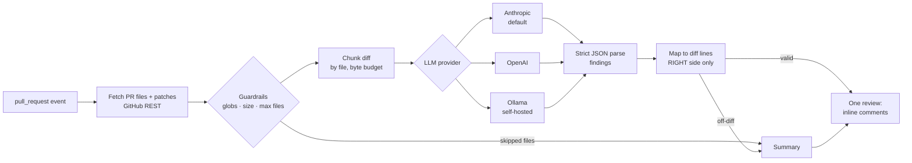

# ai-code-review-action

A GitHub Action that reviews pull requests with an LLM and posts **one** review with inline comments, **only on
lines the PR actually changed**, under hard cost limits.

> **Status: in active development.** Built in public, one pull request per milestone. See [Roadmap](#roadmap).
> The review engine works end to end against the real GitHub API, but it has **not yet been run against a live
> model**. Every provider test uses a mock.

## The problem

LLM review bots usually fail in one of three ways:

1. **Noise.** They comment on unchanged code, repeat the same finding on every push, or flag style a linter
   already enforces. Reviewers learn to ignore them.
2. **Broken anchors.** The model invents a line number. GitHub rejects the whole review with `422`, or the comment
   lands on the wrong line.
3. **Unbounded cost.** A lockfile update or a generated client sends 2 MB of diff to a frontier model.

This action deals with each of these in code. It does not rely on the prompt alone:

- Findings are **validated against the diff hunks**. A finding on a line outside the diff never becomes an inline
  comment. It moves to the review summary or is dropped ([ADR-0001](docs/adr/0001-comment-only-on-diff-lines.md)).
- Every vendor's **native structured output** (a JSON schema) is used, and the result is parsed again strictly
  ([ADR-0002](docs/adr/0002-pluggable-providers-with-native-structured-output.md)).
- **Guardrails come before any model call.** These are max files, max diff bytes, max output tokens and
  include/exclude globs. Lockfiles, generated code and binaries are excluded by default.
- **The diff is treated as untrusted input.** The action never executes PR code. It asks for no write permission
  beyond posting a review, and its prompt says that instructions inside the code are data, not commands
  ([ADR-0003](docs/adr/0003-diff-is-untrusted-input.md)).

## How it works



| Step     | Module                          | Notes                                                                                                                   |
| -------- | ------------------------------- | ----------------------------------------------------------------------------------------------------------------------- |
| Fetch    | `src/github.ts`                 | `pulls.get` + paginated `pulls.listFiles`: per-file patches, no checkout                                                |
| Filter   | `src/filter.ts`                 | include/exclude globs, per-file byte cap, skip deleted/binary files, `max-files`                                        |
| Diff     | `src/diff/patch.ts`             | parse hunks into commentable `RIGHT`-side lines; render the patch with explicit new-file line numbers for the model     |
| Chunk    | `src/chunk.ts`                  | whole files per request (about 60 KB), hard `max-diff-bytes` total. Files over budget are skipped, never truncated      |
| Prompt   | `src/prompt.ts`                 | PR title, description and diffs inside random-nonce `UNTRUSTED` markers; injection rules in the system prompt           |
| Provider | `src/providers/`                | `complete({system, user, schema})`. Anthropic SDK, OpenAI and Ollama over `fetch`. Typed refusal/truncation errors      |
| Validate | `src/findings.ts`               | one shared JSON schema, then a strict re-check. Findings for files not in that request are dropped as invented          |
| Map      | `src/review/map.ts`             | severity threshold, de-duplication, anchor check, inline cap of 25. Everything else goes to the summary                 |
| Post     | `src/review/payload.ts`, engine | one `COMMENT` review pinned to the head SHA. On `422` (diff moved under us), re-posts with every finding in the summary |

Failure handling: if one request fails (refusal, truncation, bad JSON, HTTP error), the review is still posted and
marked **partially reviewed**. If every request fails, the step fails and nothing is posted. If there are no
findings, nothing is posted. The `status` output and the job log say so, to avoid "LGTM" noise on every push.

## Usage

```yaml
# .github/workflows/ai-review.yml
name: AI review
on:
  pull_request:
    types: [opened, synchronize, reopened, ready_for_review]

permissions:
  contents: read
  pull-requests: write

# A new push makes the running review obsolete.
concurrency:
  group: ai-review-${{ github.event.pull_request.number }}
  cancel-in-progress: true

jobs:
  review:
    if: ${{ !github.event.pull_request.draft }}
    runs-on: ubuntu-latest
    steps:
      - uses: adilKhan72/ai-code-review-action@v0 # not released yet; see Roadmap
        with:
          provider: anthropic
          api-key: ${{ secrets.ANTHROPIC_API_KEY }}
          max-files: 30
          max-diff-bytes: 200000
          exclude: |
            **/*.lock
            dist/**
```

> Pull requests from forks do not receive repository secrets with `pull_request`. Do not switch to
> `pull_request_target` to work around this unless you understand the risk. This action never checks out PR code,
> but other steps in your job might.

## Configuration

`action.yml` is the source of truth.

| Input                 | Default                         | Purpose                                                                          |
| --------------------- | ------------------------------- | -------------------------------------------------------------------------------- |
| `provider`            | `anthropic`                     | `anthropic`, `openai` or `ollama`                                                |
| `model`               | `claude-opus-5-5` for Anthropic | Model id. **Required** for OpenAI and Ollama                                     |
| `api-key`             | none                            | Provider API key (not needed for Ollama)                                         |
| `base-url`            | vendor default                  | e.g. a self-hosted Ollama URL or an OpenAI-compatible gateway                    |
| `effort`              | `medium`                        | Anthropic effort (`low` … `max`), always sent explicitly                         |
| `github-token`        | `${{ github.token }}`           | Token used to read the PR and post the review                                    |
| `include`             | `**`                            | Newline-separated globs                                                          |
| `exclude`             | none                            | Added to built-in excludes (lockfiles, `dist/`, `vendor/`, minified, maps, SVGs) |
| `no-default-excludes` | `false`                         | Drop the built-in excludes                                                       |
| `max-files`           | `30`                            | Files above this count are skipped and listed in the summary                     |
| `max-file-bytes`      | `50000`                         | Skip any single file whose patch is larger                                       |
| `max-diff-bytes`      | `200000`                        | Total patch bytes sent to the model across all requests                          |
| `max-output-tokens`   | `16000`                         | Per-request output cap                                                           |
| `min-severity`        | `low`                           | Drop findings below `low` / `medium` / `high` / `critical`                       |
| `skip-draft`          | `true`                          | Do nothing on draft PRs                                                          |
| `dry-run`             | `false`                         | Log the review payload instead of posting it                                     |
| `config-path`         | `.github/ai-review.yml`         | Repository config file, read from the base commit                                |
| `reviewer-login`      | `github-actions[bot]`           | Whose earlier comments count for de-duplication. Change it when using a PAT/App  |

Outputs: `status` (`reviewed`, `clean`, `dry-run`, `skipped`), `inline-comments`, `summary-findings`,
`review-url`.

### Provider details

- **Anthropic:** official `@anthropic-ai/sdk`, beta Messages endpoint, adaptive thinking, structured output via
  `output_config.format` (JSON schema), explicit `effort`, and server-side refusal fallback (`fallbacks: "default"`,
  beta `server-side-fallback-2026-07-01`). `stop_reason` is checked for `refusal` and `max_tokens` before content
  is read.
- **OpenAI:** Chat Completions with `response_format: json_schema, strict: true`. `refusal` and
  `finish_reason: length` are mapped to typed errors.
- **Ollama:** `/api/chat` with `format: <schema>`, `stream: false`, temperature 0.

### Repository config: `.github/ai-review.yml`

Optional. House rules and overrides that live with the code:

```yaml
rules: # up to 20, each up to 500 characters; added to every prompt
  - Money is integer cents. Flag floats used for currency.
  - Every new API endpoint needs an authorization check.
min-severity: medium # overrides the input
include: ['src/**', 'app/**'] # overrides the input
exclude: ['**/*.generated.ts'] # added to the input's excludes
max-files: 20 # overrides the input
```

- The file is read from the PR's **base commit**, not the head. A pull request cannot loosen the rules it is reviewed
  under, or inject its own "rules" into the prompt.
- Unknown keys produce a warning. Wrong types fail the step with a message naming the key.
- This repository's own [`.github/ai-review.yml`](.github/ai-review.yml) is a working example.

### Re-runs and new pushes

Every finding the action posts carries a hidden fingerprint: a hash of the path, the normalised title and the
**text** of the flagged line. Before posting, the action collects fingerprints from earlier comments and review
summaries written by `reviewer-login` (default `github-actions[bot]`), and drops findings that were already
reported. If the flagged line itself changes, the finding counts as new. If nothing new remains, nothing is posted.

## Roadmap

| Milestone | Scope                                                                                                                                                                  | Status  |
| --------- | ---------------------------------------------------------------------------------------------------------------------------------------------------------------------- | ------- |
| 0         | README, ADRs, licence                                                                                                                                                  | Done    |
| 1         | TypeScript action skeleton: `action.yml`, inputs, vitest, eslint, esbuild bundle in `dist/`, CI that verifies `dist/` is current                                       | Done    |
| 2         | Review engine: fetch diff, filter, chunk, provider interface (Anthropic, OpenAI, Ollama), strict JSON findings, diff-line mapping, single review, cost guardrails      | Done    |
| 3         | `.github/ai-review.yml` config (rules, threshold, ignore paths), no duplicate comments on re-runs                                                                      | Done    |
| 4         | Dogfood with a live model on this repo and on [loan-underwriting-ai](https://github.com/adilKhan72/loan-underwriting-ai). Publish real review examples and cost per PR | Planned |
| 5         | Optional Playwright E2E test suggestions from linked user stories                                                                                                      | Planned |
| 6         | `v1` release and GitHub Marketplace listing                                                                                                                            | Planned |

## Development

```bash
npm ci
npm run all      # prettier check, eslint, tsc, vitest, esbuild bundle
```

The action runs from the committed bundle `dist/index.cjs` on the `node24` runtime. CI rebuilds it and fails if
the committed copy is stale. A `self-test` job then runs the bundle as a real action (`uses: ./`) against the PR
itself, with real GitHub API calls and a mock model server (`scripts/mock-ollama.mjs`), in dry-run mode.

**Not yet run against a live model.** No provider key is available to this project yet, so every provider test
uses a mocked SDK client or `fetch` and asserts the exact request shape. Live dogfooding is Milestone 4.

## Architecture decisions

- [ADR-0001: Comment only on diff lines](docs/adr/0001-comment-only-on-diff-lines.md)
- [ADR-0002: Pluggable providers with native structured output](docs/adr/0002-pluggable-providers-with-native-structured-output.md)
- [ADR-0003: The diff is untrusted input](docs/adr/0003-diff-is-untrusted-input.md)

## Licence

[MIT](LICENSE) © 2026 Adil Khan
